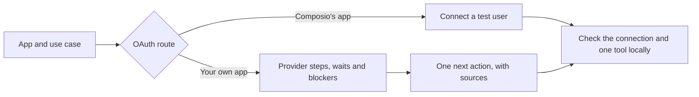
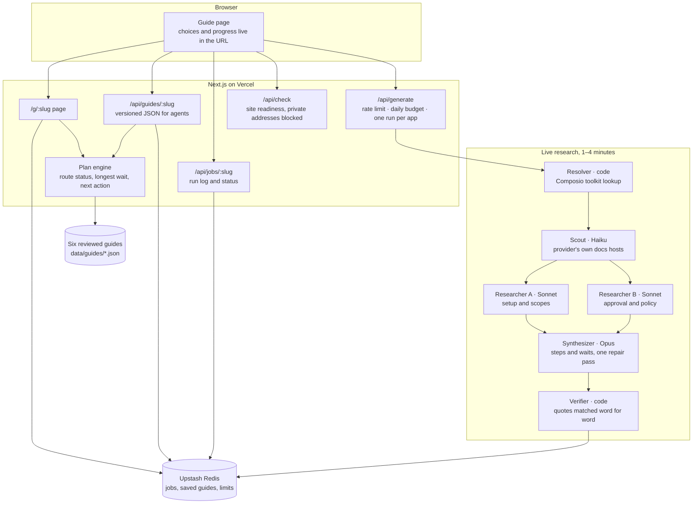

# Clearance

[Try the live app](https://clearance-oauth.vercel.app) · [View the source](https://github.com/nanddave/clearance-oauth)

Clearance helps a developer answer a practical OAuth question: **Can I use Composio's app, or do I need my own?** If they need their own app, it shows the likely launch path, the longest blocker, and the next action. It separates documented provider facts from user-reported progress and things it cannot verify.

The app is a decision aid. It does not connect to your Composio account, submit provider applications, or claim a connection works without a real test.

## Try it in five minutes

1. Open [Gmail](https://clearance-oauth.vercel.app/g/gmail). Choose **Read and send** and **Anyone with a Google account**. Compare Composio's managed route with **Your own app**. The scope choice changes the approval path.
2. In **Your own app**, open **Journey to launch** and tick a step or requirement. The next action and shareable URL update. A tick means the user reported progress; it is not connection verification.
3. Compare [GitHub](https://clearance-oauth.vercel.app/g/github) (simpler setup), [Gusto](https://clearance-oauth.vercel.app/g/gusto) (partner gate), and [DocuSign](https://clearance-oauth.vercel.app/g/docusign) (provider review). Open **Sources and evidence** on a guide to inspect its claims.
4. Open a guide the agents researched live: [Notion](https://clearance-oauth.vercel.app/g/notion), [Calendly](https://clearance-oauth.vercel.app/g/calendly) or [HubSpot](https://clearance-oauth.vercel.app/g/hubspot). Each took one to four minutes and under $1, and is labelled agent-generated. Typing another app starts new research, within a daily budget.
5. Open the [Gmail JSON guide](https://clearance-oauth.vercel.app/api/guides/gmail?t.uses=read_send&t.audience=external&lane=own). Its `decision` distinguishes route availability, reported setup progress, and unknown connection and tool results.

To try it with a coding agent, point it at that JSON and ask: “Can a real user read and send Gmail now? Which evidence supports the answer, what remains unknown, and what should be tested next?”

## Choose the path that fits your use case

| Choice | What you can change | Where it appears |
|---|---|---|
| App | Pick a reviewed guide or enter another provider | Search on the home page |
| Intended use and audience | Choose scopes, audience, or distribution when they alter provider requirements | Questions at the top of a guide |
| OAuth route | Compare Composio's managed app with your own provider app | Route cards on a guide |
| Your progress | Tick completed steps and requirements; share the resulting URL | Journey to launch and Requirements |

The page shows one next action, its owner, and any prepared material. Provider account creation, payment, consent, and final submission still belong to the developer. Local setup examples use the developer's own environment; do not paste secrets into the site or a shared URL.



## Architecture



Code does everything that needs no judgment: lookups, checks, the timeline maths and the route answer. Models only read documentation and draft the steps, and each model call is sized to its task. A generated guide is saved only after it passes structural checks; a wait or a review step that no provider quote supports is left out or marked unknown.

## Workflows

- **Use a reviewed guide.** Pick an app, set what your agent does, and compare the two routes. Tick what you already have; the next action, timeline and share link update. Copy the link to hand the plan to a teammate.
- **Research an unfamiliar app.** Type its name. The run log shows each agent, its model and its cost as it works. The finished guide is labelled agent-generated, and its link keeps working for later visitors.
- **Prove a connection.** Open **Show prepared setup and commands** on the next step and run the script on your own machine with your Composio key. It prints a connect link, waits for the account to become active, then runs one read-only tool. Your keys never reach this site.
- **Fix a failed connection.** Paste the error text into **Connection not working?** for known causes and fixes.
- **Let an agent decide.** Fetch `/api/guides/<app>?t.<choice>=<option>` and read `decision`: the state of each route, what is reported and what is still unknown.

## Prompts to explore it with an agent

Point a coding agent at the [repository](https://github.com/nanddave/clearance-oauth) or a JSON guide and try:

- "Fetch https://clearance-oauth.vercel.app/api/guides/gmail?t.uses=read_send&t.audience=external. Can my users connect today through Composio's app, and what would it take to launch with our own Google app? Cite the claims you rely on."
- "Compare the Gmail JSON for `t.uses=send` and `t.uses=read`. Which gates change, and why does the launch time change?"
- "Read src/lib/next.ts and explain how `routeStatus` decides between 'Test today', 'scopes unconfirmed' and 'Not available'."
- "Read src/agents/pipeline.ts and src/agents/verify.ts. Which parts use a model, which are plain code, and how is a claim marked Official?"
- "Open https://clearance-oauth.vercel.app/g/notion. Which facts are official, which are unknown, and what should a developer ask Notion before launch?"

## Run locally

Requires Node.js and pnpm. Copy the example environment file and fill in only the services you intend to use.

```bash
pnpm install
cp .env.example .env.local
pnpm dev
```

Open `http://localhost:3000`. In another terminal:

```bash
pnpm test
pnpm lint
node scripts/smoke.mjs http://localhost:3000
```

| Setting | Purpose | If omitted |
|---|---|---|
| `ANTHROPIC_API_KEY` | Live research for unfamiliar apps | Explicitly labelled placeholder guides |
| `COMPOSIO_API_KEY` | Look up managed OAuth coverage | Coverage remains unknown for new research |
| `UPSTASH_REDIS_REST_URL` and `UPSTASH_REDIS_REST_TOKEN` | Share research jobs across server instances | In-memory jobs, suitable for local development |
| `DAILY_BUDGET_USD` | Limit live research spend | Defaults to $10 per day |

On Vercel, the Upstash integration may supply `KV_REST_API_URL` and `KV_REST_API_TOKEN` instead. Keep `.env.local` private. The checked-in guides and their JSON API work without model keys.

## How it works

Six guides are reviewed in the repository. For other providers, a resolver checks Composio's toolkit data, research agents read provider documentation, and a verifier checks captured links and quotations. A guide passes structural checks before it is saved. The route and next action are then computed from the chosen use case and reported progress.

Evidence labels mean: **Official** is a matching quotation from fetched provider documentation; **Reported** is weaker evidence; **Unknown** has not been established. A generated guide is not human-reviewed. A green route describes a possible path, not a proven connection for a particular user. To establish that, the developer must authorize a test account and run an appropriate tool with the granted scopes.

More detail: [architecture and limitations](docs/decisions.md), [live research runs](docs/live-research.md), and [provider research](docs/research/2026-10-27-provider-facts.md).
