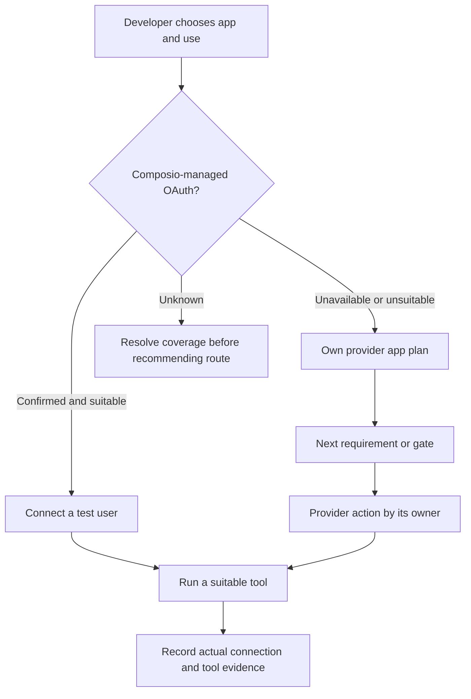
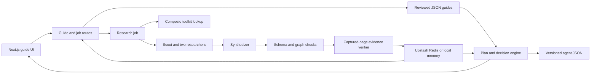

# Clearance — product requirements and submission plan

**Owner:** Nand · **Version:** 28 October 2026 · **State:** submission candidate; account-level proof pending

## 1. Executive decision

Clearance should be presented as an honest OAuth launch navigator, not as a service that has already connected a user's account. The most convincing demonstration is a reviewer choosing a use case, seeing how that changes the route and launch plan, inspecting the cited evidence, and getting one actionable next step. The live experience now matches this claim, and the production research path has been checked after the Composio Platform key update.

The near-term investment is reliability and proof, not more provider pages. A working managed-route lookup and one real account/tool test would improve the product more than another unverified feature. No external judging rubric is available, so a promised change of 10 or 12 points cannot be calculated.

## 2. User and problem

**Primary user:** a developer building an agent whose customers connect their own SaaS accounts through Composio. They need to decide whether a managed OAuth app fits the desired scopes and branding, or whether to register and launch their own provider app.

**Pain:** provider documentation is scattered across developer portals, approval guides, pricing, and support pages. An agent can find facts, but a developer still needs the facts translated into a use-specific route, a plausible timeline, an owner, and the next action. Generic advice can hide a partner gate or invent a review queue.

**Job to be done:** “For this app and what my agent needs to do, tell me what route is available, what blocks launch, what I can do next, and what still needs a real connection test.”

## 3. Product promise and boundaries

| Clearance provides | Clearance does not claim |
|---|---|
| A route comparison and use-specific plan | That every managed app supports every requested scope |
| Provider steps with citations and uncertainty labels | That a user-reported tick is independently verified |
| A next action and prepared local material where possible | That it created an OAuth app or submitted an application |
| A versioned guide for coding agents | That a real user connected or a tool worked without execution evidence |

The product never asks for provider secrets in the browser. The developer runs connection examples in their own environment and confirms the exact toolkit, scopes, and read-only tool before using them.

## 4. Experience and customization

1. **Choose an app.** Search the six reviewed guides or request research for another provider. The latter is visibly labelled agent-generated.
2. **Describe the use case.** Show only choices that change the plan, such as Gmail read versus send, external versus internal audience, or optional marketplace distribution.
3. **Compare routes.** A managed app can be available, unavailable, scope-unconfirmed, or unknown. The own-app route shows its difficulty and time, with unknown waits called out.
4. **Act.** Display one next action, its owner, expected wait, source, and prepared material. Let users open the full path when needed.
5. **Record progress.** Requirements and completed steps are stored in the URL for sharing. Their provenance remains user-reported.
6. **Prove the connection.** Local instructions lead to an authorized test user and an appropriate tool call. The guide itself keeps connection and action status unknown until such proof exists.

### Reviewer path

The README must give a five-minute route through Gmail, a simpler app, a gated app, provider evidence, and the JSON endpoint. It should name the limitation of user-reported progress and make live research costs visible without presenting internal evaluation criteria. Existing researched examples can be reviewed without starting another paid run.

## 5. Functional requirements

| ID | Requirement | Acceptance condition | Current state |
|---|---|---|---|
| F1 | Use-specific route and plan | Changing a meaningful toggle changes the relevant gates, clocks, and next action | Implemented for reviewed guides |
| F2 | Conservative managed route | Failed or missing Composio lookup returns unknown, never a claim of availability | Implemented; fresh production runs resolved Notion, Calendly, and HubSpot coverage |
| F3 | Evidence for generated claims | Links must have been fetched; official quotations must match provider text | Implemented |
| F4 | No invented mandatory review | A review gate needs a direct source that the provider reviews apps; uncertain questions do not create a required gate | Implemented; refreshed Calendly guide has no mandatory review gate |
| F5 | Actionable next step | Show the action, owner, and what to ask for an unknown wait | Implemented; verify in fresh pilot |
| F6 | Honest progress and execution state | Ticks remain reported; connection and tool results stay unknown without real execution | Implemented |
| F7 | Reviewer-ready documentation | README explains the demo, choices, architecture, setup, evidence, and limits; research report preserves findings without internal scoring | Complete |
| F8 | Deployment check | Automated tests, lint, build, and HTTP smoke agree with the current JSON contract | Tests, lint, and public HTTP smoke passed; production build checked locally |

### Quality bar for generated guides

The verifier must remove an unsupported provider review gate and keep its uncertainty visible rather than give it a slower tier. A provider wait needs a matching source for its number; otherwise the wait is unknown with a question for the provider. Optional listing or certification must not block the default use case. A failed research run must leave the last finished guide available and labelled as stale.

## 6. Architecture and data flow

The six reviewed guides live under `data/guides/`. A request for an unfamiliar app starts a background research job; Redis shares its events and saved result between server instances. The plan engine combines the guide with selected use, route, requirements, and reported progress. The page and JSON endpoint read the same decision logic. The public site does not retain the developer's Composio or provider credentials.

**Operational settings:** `ANTHROPIC_API_KEY` for real research; `COMPOSIO_API_KEY` for the Platform toolkit lookup; Upstash REST or Vercel `KV_*` credentials for shared jobs; `DAILY_BUDGET_USD` for the research cap. Missing keys produce labelled unknown or placeholder results, not silent success.

## 7. Pilot and release checks

Three fresh production guides cover a simple self-serve route (Notion), the formerly unsupported review path (Calendly), and a more complex provider (HubSpot). They finished in 223, 68, and 118 seconds respectively at $0.46, $0.47, and $0.65: $1.57 total. The Composio resolver reported managed OAuth coverage for all three, and the refreshed Calendly guide contains no mandatory review gate. No additional paid research is needed for this submission pass.

Release checks:

- Unit tests and lint pass, and a production build succeeds.
- HTTP smoke covers a reviewed guide, versioned JSON, a missing guide, and a rejected private address.
- A fresh guide does not turn a hypothetical provider review into a mandatory gate.
- A research run on the newer production deployment confirms toolkit coverage; an invalid credential remains a visible launch blocker.
- One developer-controlled test account reaches a real connection and executes a suitable tool. Record the result or explicitly state that this proof was not obtained.
- README links match the deployed behavior, and no submission-facing report contains internal grading language.

## 8. Risks, owners, and next decisions

| Priority | Risk or dependency | Owner and decision |
|---|---|---|
| Resolved | Old research jobs saw Composio HTTP 401 | Fresh production jobs resolved managed OAuth coverage for Notion, Calendly, and HubSpot |
| Resolved | Old Calendly guide implied a review not shown in its cited source | Refreshed guide has only developer-account and production-app steps; no mandatory review gate |
| P1 | No real user connection or tool execution has been demonstrated | Developer runs a safe test from their own account and records the Composio log ID |
| P1 | Documentation edits must reach the repository before submission | Commit and push the final PRD and README/report cleanup |
| P2 | Generated guide quality varies with provider documentation | Keep the generated label, source inspection, and a bounded review process |

**CEO recommendation:** submit the assignment once this documentation is pushed. The live product and fresh research meet the reviewer path. Disclose that no developer-controlled account connection and tool execution were obtained; do not imply end-to-end proof. If the assignment explicitly requires a working OAuth connection, run that test before submitting. Defer screenshot parsing, reminders, more providers, and extra model cross-checks until account-level proof is available.
